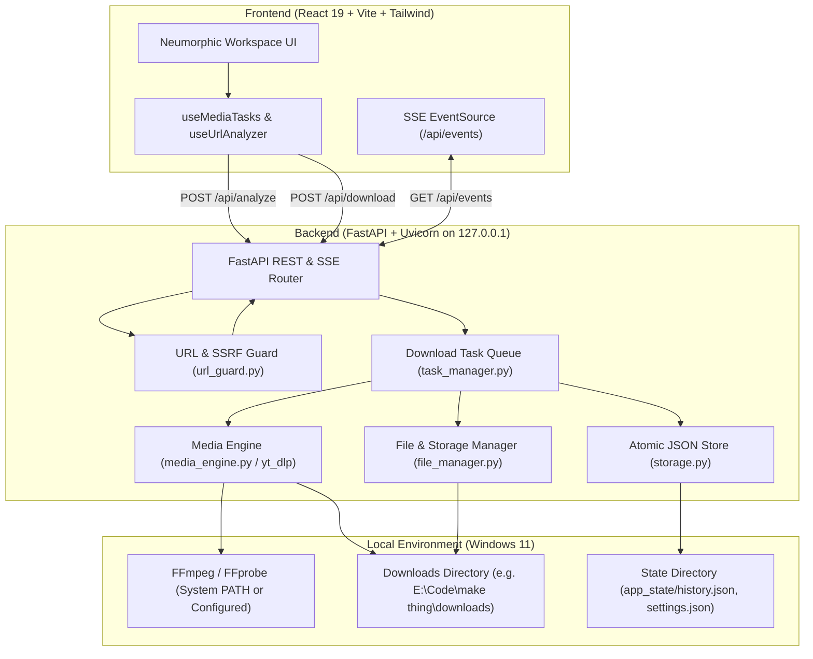

# KON Media — System Architecture

## 1. Architectural Overview

**KON Media** is built as a modular, local-first desktop media application. It operates strictly on the user's local machine without external database servers, cloud backends, or recurring service costs.

---

## 2. Component Responsibilities

### 2.1 Frontend Presentation (`frontend/`)
* **Technology**: React 19, Vite, Tailwind CSS, Lucide React icons.
* **Responsibilities**:
  * Renders the Neumorphic Media Workspace adhering strictly to `docs/DESIGN-SYSTEM.md`.
  * URL input with clipboard paste button, format selector (Video / Audio with quality tiers).
  * Real-time Task Monitor subscribing to Server-Sent Events (`/api/events`) for live download percentage, transfer speed, and ETA.
  * Local history table with status indicators and "Open in Explorer" triggers.
  * System health display verifying `yt-dlp` and `ffmpeg` operational readiness.

### 2.2 Ingress & Security Guard (`backend/security/url_guard.py`)
* **Responsibilities**:
  * Validates URL schemes strictly to `http` and `https`.
  * Parses hostnames and IP addresses to prevent Server-Side Request Forgery (SSRF) and local network scanning.
  * Blocks loopback addresses (`127.0.0.1`, `localhost`, `::1`), link-local/cloud metadata (`169.254.169.254`), and RFC1918 private subnets (`10.0.0.0/8`, `172.16.0.0/12`, `192.168.0.0/16`).
  * Protects against malicious query parameters and shell metacharacter injection.

### 2.3 Media Engine (`backend/engine/media_engine.py`)
* **Responsibilities**:
  * Programmatic interface wrapping `yt_dlp.YoutubeDL`.
  * Runs extraction (`extract_info`) without downloading to deliver structured format options, title, thumbnail, duration, and channel metadata.
  * Configures download options with custom progress hooks:
    * `status == 'downloading'`: Emits bytes downloaded, total bytes, instantaneous speed, and estimated time remaining.
    * `status == 'finished'`: Transitions state to `processing` (FFmpeg remuxing or audio extraction).
  * Supports real cancellation via thread-safe abort flags and process interruption.

### 2.4 Download Task Manager (`backend/tasks/task_manager.py`)
* **Responsibilities**:
  * Maintains an in-memory queue of active tasks with state machine:
    $$\text{Queued} \longrightarrow \text{Analyzing} \longrightarrow \text{Downloading} \longrightarrow \text{Processing} \longrightarrow \text{Completed} \mid \text{Failed} \mid \text{Cancelled}$$
  * Limits concurrent downloads (default: 2 simultaneous jobs) to prevent CPU and disk saturation.
  * Emits event notifications to all connected SSE clients.
  * Writes completed tasks to persistent history.

### 2.5 File & Output Management (`backend/storage/file_manager.py`)
* **Responsibilities**:
  * Sanitizes output filenames for Windows compatibility: removes illegal characters (`\/:*?"<>|`), strips trailing dots/spaces, truncates filenames exceeding 120 characters, and avoids Windows reserved device names (`CON`, `PRN`, `AUX`, `NUL`, `COM1-9`, `LPT1-9`).
  * Overwrite protection: appends `(1)`, `(2)`, etc., if a file with the destination name already exists.
  * Temp file cleanup: safely purges aborted or partial downloads (`.part`, `.ytdl`).
  * Windows Shell Integration: provides a clean local API (`POST /api/open-folder`) that opens Windows File Explorer directly with the downloaded file selected using `explorer.exe /select,"<path>"`.

### 2.6 Persistence Layer (`backend/storage/storage.py`)
* **Responsibilities**:
  * Zero-database atomic JSON persistence.
  * Saves `history.json` and `settings.json` using atomic temporary file creation followed by `os.replace()` to guarantee file integrity even during unexpected system power loss or process termination.

---

## 3. Communication Protocols & Data Flow

### 3.1 Metadata Analysis Flow
1. User enters URL in Frontend and clicks **Analyze**.
2. Frontend calls `POST /api/analyze` with JSON `{ "url": "..." }`.
3. `url_guard.py` validates protocol and destination address.
4. `media_engine.py` calls `extract_info(url, download=False)`.
5. Backend parses and deduplicates available video resolutions and audio bitrates, returning structured JSON to frontend.

### 3.2 Download & Real-Time Progress Flow
1. User selects format (e.g. 1080p MP4 or 320kbps MP3) and clicks **Download**.
2. Frontend calls `POST /api/download` with `{ "url": "...", "format_id": "...", "type": "video|audio" }`.
3. `task_manager.py` creates a task record with UUID and places it in the task queue.
4. Worker thread picks up the task and begins `yt_dlp.YoutubeDL.download()`.
5. yt-dlp `progress_hook` fires periodically and updates task state (percent, speed, ETA).
6. FastAPI SSE endpoint `/api/events` broadcasts state updates to all subscribed browser windows.
7. Upon completion, file integrity is verified on disk, history record is persisted atomically, and status is updated to `completed`.

---

## 4. Windows 11 Desktop Integration

* **Service Binding**: Binds exclusively to `127.0.0.1` (loopback only) to ensure no exposure across the local area network or internet.
* **Path Resilience**: Normalizes all file paths using `pathlib.Path`, properly handling Windows drive letters (`E:\...`), backslashes, and long path constraints.
* **Process Cleanup**: Uses Python subprocess and thread management with explicit timeout handling to prevent orphaned zombie processes.
