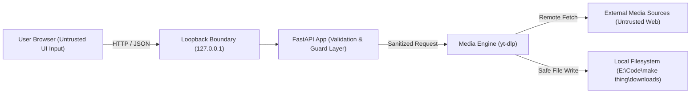

# KON Media — Security Architecture & Threat Model

## 1. Security Overview

**KON Media** is a personal desktop media utility running locally on Windows 11. Even though the application is intended for single-user desktop use, running a web-based interface backed by a media-processing engine introduces critical security boundaries that must be strictly defended.

---

## 2. Threat Model & Trust Boundaries



### 2.1 Untrusted Inputs
* **User-Provided URLs**: May contain shell metacharacters, file URIs (`file:///`), local loopback targets (`http://127.0.0.1`), cloud metadata endpoints (`http://169.254.169.254`), or private intranet hosts (`http://192.168.1.1`).
* **Remote Media Metadata**: Titles and filenames returned from remote extractors may contain path traversal sequences (`../../`), Windows reserved device names (`CON`, `PRN`), or script payloads.
* **Format Identifiers**: Must be validated against known alphanumeric patterns.

### 2.2 Trusted Inputs
* **Local Backend Configuration**: Verified local directory paths, default port assignments, local file stores.

---

## 3. Threat Mitigation Matrix

| Threat | Risk Level | Mitigation in KON Media |
| :--- | :--- | :--- |
| **Command Injection** | Critical | **No shell execution**. The media engine runs via the direct Python `yt_dlp` library or structured argument lists (`subprocess.run(list, shell=False)`). Shell metacharacters are never interpreted. |
| **Server-Side Request Forgery (SSRF)** | High | **URL Guard (`url_guard.py`)**. Schemes restricted to `http` and `https`. Resolves hostnames and rejects private RFC1918 subnets, loopback addresses, link-local addresses, and cloud metadata hostnames (`metadata.google.internal`). |
| **Path Traversal & Overwrite** | High | **Filename Sanitizer (`file_manager.py`)**. Strips directory separators (`/`, `\`), null bytes, and traversal tokens (`..`). Strips Windows reserved device names (`CON`, `PRN`, `AUX`, `NUL`, etc.). Overwrite protection appends numeric counters. |
| **Arbitrary Filesystem Access** | High | Output directories are restricted to the configured local downloads directory. File download and folder-open endpoints reject paths outside the authorized root. |
| **Network Exposure** | Medium | The Uvicorn server binds strictly to `127.0.0.1` (loopback interface). It does not bind to `0.0.0.0` or expose open network sockets. |
| **Resource Exhaustion** | Medium | A bounded task queue restricts concurrent active downloads (default: 2). Requests exceeding limits are queued or rejected. Subprocess execution has strict timeouts. |
| **Credential / Cookie Leakage** | Medium | No automatic browser cookie harvesting or password extraction. Local logs sanitize query strings and authorization headers. |

---

## 4. Specific Security Defenses

### 4.1 URL Guard Implementation
```python
# Protocol check:
if scheme not in ("http", "https"):
    raise ValidationError("Only HTTP and HTTPS URLs are permitted.")

# SSRF and Host check:
# Rejects localhost, 127.0.0.1, ::1, 169.254.169.254
# Rejects 10.0.0.0/8, 172.16.0.0/12, 192.168.0.0/16
```

### 4.2 Windows Filename Sanitization
```python
# Characters illegal on Windows NTFS/FAT32: \ / : * ? " < > |
# Plus control characters (0x00-0x1F)
# Plus Windows reserved device names: CON, PRN, AUX, NUL, COM1-9, LPT1-9
# Maximum safe filename length: 120 characters before extension.
```

### 4.3 Safe Windows Shell Execution
When opening the downloaded file in Windows File Explorer:
* The absolute path is validated to ensure it resides within the allowed download directory.
* The system invokes `explorer.exe /select,"<sanitized_path>"` using structured argument arrays, avoiding arbitrary shell command execution.

---

## 5. Security Testing

Security controls are verified as part of the automated test suite (`tests/test_security.py`), covering:
* Injection of command separators (`;`, `&`, `|`, `` ` ``, `$()`) in URLs.
* SSRF attempts against loopback (`http://127.0.0.1:8000`), link-local metadata (`http://169.254.169.254/latest/meta-data/`), and local router gateways (`http://192.168.1.1`).
* Path traversal strings in download requests (`../../windows/system32`).
* Windows device name collisions (`CON.mp4`, `NUL.mp3`).
